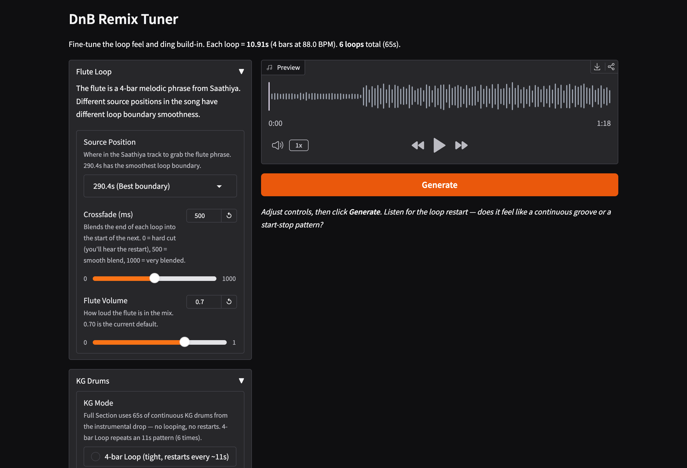

# Saathiya x Kho Gayi — Bollywood DnB, Built by Ear

> I haven't written Python since 2014. Every line of code in this project was written by [Claude Code](https://docs.anthropic.com/en/docs/claude-code) through conversational prompting. My only tools were my ears and natural language.

A Bollywood drum & bass remix: Saathiya's dreamy flute melody looped over Kho Gayi's drum break, beat-synced at 88 BPM (half-time DnB), with tanh bass distortion and a snap transition from vocals to drop.

**37 scripts. 10,768 lines of code. 491 audio renders. 4 sittings, 8 months apart. Zero DAW.**

## The Final Track

[**Listen in browser**](https://kk95.github.io/dnb-remix/docs/) | [Download the long version (2:57)](samples/17-final-long-version.mp3) ([lossless WAV](https://github.com/kk95/dnb-remix/releases/download/long-version/saathiya-x-kho-gayi-long-version.wav)) | [The February version (1:17)](samples/13-final-full-section.mp3)

Sonu Nigam opens with "teri ek hansi ke badle", Kho Gayi's drums tease in underneath and pull out so Saathiya's bassline leads into a half-time drop, where "hanste rehna" lands. The antara gets room to breathe, builds back, and breaks into a 176 BPM two-step built from Kho Gayi's own kick and snare.

## The Spark

Spotify has a beta feature that auto-mixes songs in a playlist — beat-syncing transitions between tracks. I had Saathiya and Kho Gayi back to back, and the transition it created was magic: Saathiya's dreamy flute ending flowing straight into Kho Gayi's beat drop.

I screen-recorded the transition in spotify to study it more closely — the settings, the overlap, the beat alignment. Then I wondered: **can I turn this into an actual produced remix using nothing but prompts?**

I don't use a DAW. I haven't touched Python in over a decade. But I had Claude Code and a pair of headphones.

## The Timeline

### Day 1: February 5 — The Marathon

**2 AM to 4:30 PM. 14 hours. 437 output files.**

I started at 2 AM by asking Claude to separate both songs into stems using [Demucs](https://github.com/facebookresearch/demucs). Isolated flute, drums, bass — now I could mix them independently.

The first challenge: **the two songs are at different tempos** (87.6 vs 95.7 BPM). Early attempts used beat-to-beat warping — detecting every beat in both songs and mapping them one-to-one. This caused audible tempo wobble, like someone tapping the tempo button. I'd describe what I heard:

> "It sounds like it speeds up and slows down on every beat"

Claude would analyze why, propose a fix, generate a new render. We went through ~10 different alignment strategies in 2 hours. [Hear the wobble](https://kk95.github.io/dnb-remix/docs/#day-1).

**The breakthrough came at 5 AM.** I described how djay actually works — it just plays both tracks at the same constant BPM. Claude realized:

> "DJ software uses a single constant time-stretch, not beat-to-beat warping. One fixed rate, no wobble."

One `pyrubberband.time_stretch()` call with rate `88.0 / 95.703` solved what 10 scripts couldn't.

Even with tempo fixed, the drop *felt* wrong — always "late" even when analysis showed it was on the beat. We discovered Saathiya's vocals had no envelope (playing at full volume through the drop, burying KG) and KG had a gradual volume ramp. The fix: **snap transition**. All Saathiya stems cut to zero at the downbeat. KG enters at full volume instantly.

> SNAP transitions > smooth crossovers. The S-curve feels late.

The afternoon session focused on the **flute loop** (2-bar too short, 4-bar captured the full phrase), **bass distortion** (tanh saturation on mids/highs, clean sub below 80 Hz), and adding a KG ding build-in layer.

**Where I left off:** [Day 1 final](https://kk95.github.io/dnb-remix/docs/) — 4-bar KG drum loop, flute at 290.4s, medium bass distortion. It worked, but something about the drums felt like start-stop.

### Day 2: February 7 — Midnight Flute Hunt

**12 AM to 1 AM. 1 hour. Pure R&D.**

A quick midnight session exploring where in Saathiya to extract the flute loop. Tested 5 source positions across the song and 4 crossfade durations (500ms, 681ms, 1362ms, 2727ms). Found that **290.4s** has the best loop boundary despite not being the most obvious musical downbeat. No full remix rendered — just isolated loop tests and analysis.

### Day 3: February 14 — Zero Drum Restarts

**7 AM to 9 AM. 2 hours. The architecture fix.**

The thing that had been bugging me about Day 1's output: the 4-bar KG drum loop created **5 audible restart boundaries** every 10.91 seconds. Subtle, but once you hear it, you can't unhear it — a start-stop feel in the drums.

The fix: **use the full continuous section** from KG's post-drop instead of looping. The raw stems are 176 seconds long, giving us ~65 seconds of uninterrupted drums after the drop. Zero loop boundaries = no start-stop.

But this revealed a hidden bug: KG's **post-drop BPM is 95.0, not the global 95.703**. A 0.7% error that was imperceptible on a 10-second loop but caused 450ms of drift over 60 seconds. Fixed the stretch rate from `88.0/95.703` to `88.0/95.0`.

Built a [Gradio tuner](scripts/ding-tuner.py) for interactive parameter adjustment — flute source position, crossfade duration, volume, KG mode toggle. The final settings: flute at 0.57 volume (down from 0.70 to let drums breathe), 134ms circular crossfade.



**The February track:** [Listen](samples/13-final-full-section.mp3)

### Day 4: October 23 · The Long Version

**One sitting. 9 listening rounds. 27 full-length renders.**

Eight months later I came back with a newer Claude model and two wishes: a longer track, and some way to stitch both songs together instead of looping one riff over the other.

The first thing it did was re-measure everything, and that changed the whole project. **Saathiya is locked at exactly 88.000 BPM for all five minutes.** The 87.6 we had been using was a beat tracker artifact, and so was Kho Gayi's 95.7: it's 95.0 in both of its drops. That meant the entire song could play at native speed against a straight grid, with no stretching and no looping. The flute had only seemed to last 10 seconds because we had been cutting at one spot. The songs also turned out to sit in neighbouring keys (B major and E major), which is the classic safe pairing for mixing.

It also caught a sag in the February mix: the "full section" ran past Kho Gayi's first drop into its breakdown, so the hi-hats died out 20 seconds before the fade.

Round 1 was six 3-minute versions with different drum and bass options. Two things stood out. Kho Gayi's own second build into its second drop sounded like the opening the song was missing ([hear it](samples/14-long-version-build-into-drop.mp3)). And because one bar at 88 is two bars at 176, the flute already fits real drum and bass tempo, so a two-step built from Kho Gayi's own kick and snare dropped right in ([hear it](samples/15-dnb-176-two-step.mp3)).

> "v3 is gnarlyyy"

Then I asked whether we had looked at the lyrics at all. We hadn't. "Hanste rehna" landing on a drop had been luck. Whisper transcribed the isolated vocals with a timestamp for every word, which turned the song into phrases that could be placed on the beat. It also fixed a problem I kept hearing: the hook always started mid-word, on the tail end of "mera aasmaan le le".

Getting "hanste rehna" itself right took three tries. I kept hearing a "hmm" before it, then the end of "madham". The singer runs "madham" straight into "hanste" without a breath, and the first two cuts started inside that hum. The pitch data looked fine both times. Only ears caught it ([the final cut](samples/16-hanste-rehna.mp3)).

The rest was nine rounds of the same loop as February:

> "The hook starts mid lyric" → every vocal section starts at the top of a line
>
> "Ek hansi starting feels so unique" → Sonu opens the track
>
> "No warning it changes into d&b" → Kho Gayi's drums tease in on the second "Saathiya", then pull out so the bassline leads into the drop alone
>
> "Kho Gayi abruptly stops for Sonu" → the guitar fades out under his first two bars instead
>
> "Maybe it's worth it to slow down for him?" → yes, but the antara builds back into the drop

> "build-back is sickkk"

Last came a mastering pass, the part I almost studied (I nearly minored in Sound Recording Technology). Measured against kSaya's own Kho Gayi release, our drops had 13 dB too much energy around 125 Hz. The February "medium distortion" was also a hidden bass boost: tanh saturation multiplies quiet signals by up to 6x, so saturating everything above 80 Hz pushed the bass body up ~14 dB. Moving the split to 250 Hz kept the grit and lost the boom. The Saathiya MP3 also turned out to be completely mono, so its parts got a short stereo room. Then a gentle EQ, light glue compression, and a true-peak limiter put the drops next to Kho Gayi's loudness at -1 dBTP. Fixing the boom thinned out the 176 drop, which had been leaning on it, so its kick got a short sine body underneath; the first try was too long and made the whole mix duck on every kick, the second one stuck.

**The final track:** [Listen](https://kk95.github.io/dnb-remix/docs/)

## How Vibe Coding Works

The workflow for every change:

1. I describe what I want (or what sounds wrong)
2. Claude writes/modifies a Python script
3. The script runs, produces an MP3
4. I listen, give feedback
5. Repeat

> "The drop feels 2 seconds late"
> "The bass needs more grit but keep the sub clean"
> "It sounds like the drums restart every 10 seconds"

My ears were the quality control. Claude handled signal processing, beat analysis, time-stretching, and mix engineering — but every creative decision came from listening and describing.

**Describe the problem, not the solution.** When I said "the drop feels late," Claude investigated onset timing, envelope shapes, and phase alignment to find the actual cause. When I prescribed solutions ("add a crossfade"), they often made things worse.

**AI doesn't replace musical intuition.** Claude caught a 0.069% tempo drift through analysis — but only after I said "the flute is drifting." The inverted stretch formula was mathematically correct but musically backwards. Only ears noticed.

## Stringing Sessions Together

This project spanned multiple Claude Code sessions across 10 days. Two mechanisms kept context alive:

**[HANDOFF.md](HANDOFF.md)** — At the end of each session, Claude writes a handoff document capturing: what's done, what's next, key decisions, current mix levels, open issues. The next session reads this and starts productive immediately instead of re-discovering decisions from scratch.

**MEMORY.md** — Claude's persistent memory system. BPM values, stretch rates, timing constants, lessons learned ("local BPM ≠ global BPM"), and what approaches failed. Accumulates across sessions automatically.

## What's Under the Hood

The long version comes from [long-remix.py](scripts/long-remix.py), which describes the arrangement as a list of sections:

```text
0:00  Sonu opens: "teri ek hansi ke badle, meri ye zameen le le..." into the mukhda
0:20  Kho Gayi's drop groove teases in, muffled, on the second "Saathiya"
0:38  Drums pull out; Saathiya's bassline plays alone
0:41  DROP A: Kho Gayi's second drop, half-time, "hanste rehna" on the downbeat
1:24  Antara: "kabhi neele aasmaan pe...", Kho Gayi's guitar fading out underneath
1:45  Build-back: Kho Gayi's drums creep in from "teri baali hil gayi hai"
2:03  DROP B: 176 BPM two-step, rolling into a 4-second fade
```

The February version still comes from [flute-loop-drop.py](scripts/flute-loop-drop.py).

Key techniques:

- **Stem separation** via Demucs (htdemucs_ft model)
- **Time-stretching** via pyrubberband (constant rate, pitch-preserved)
- **4-bar flute loop** tiled with 134ms circular crossfade
- **Full-section KG drums** — 65s continuous, no looping
- **Bass distortion** via tanh saturation with clean sub (<80 Hz) preservation
- **Snap transition** — per-stem volume envelopes, instant cut at the downbeat
- **Grid-locked arrangement**: Saathiya at native speed, Kho Gayi stretched once by 88/95 with Rubber Band's R3 engine
- **176 BPM drum kit** ([dnb_kit.py](scripts/dnb_kit.py)): Kho Gayi's kick and snare averaged across a dozen hits to cancel bleed, synthesized hats
- **Lyric timing**: [Whisper](https://github.com/ml-explore/mlx-examples/tree/main/whisper) word timestamps ([transcribe-lyrics.py](scripts/transcribe-lyrics.py)), cut points snapped to the gaps between words ([find-adlibs.py](scripts/find-adlibs.py))
- **Mastering**: tonal balance and loudness matched against the Kho Gayi release, EQ + glue compression, stereo room for the mono Saathiya source, 4x-oversampled limiter at -1 dBTP

The [Gradio tuner](scripts/ding-tuner.py) (568 lines) provides an interactive UI for adjusting flute source, crossfade, volumes, and KG mode in real-time.

## The Numbers

| Metric | Count |
| ------ | ----- |
| Python scripts | 34 |
| Lines of code | 10,247 |
| Audio renders generated | 464 |
| Analysis plots | 46 |
| Approaches tried and abandoned | ~12 |
| Active days | 4 (February, plus one sitting in October) |
| Total hours | ~17 in February, one long sitting in October |
| Listening rounds for the long version | 9 |
| Key bugs found through listening | 4 |

The 4 bugs only ears could catch:

1. **Tempo wobble** — beat-to-beat warping, fixed by constant stretch
2. **Late-feeling drop** — vocals masking KG entry, fixed by snap transition
3. **Inverted stretch formula** — 0.99931 instead of 1.000694, fixed by correcting the ratio direction
4. **Drum loop restarts** — 4-bar loop creating start-stop feel, fixed by full continuous section

## Project Structure

```text
docs/                                 # GitHub Pages audio player
  index.html

samples/                              # Curated audio for this README
  01-early-transition-attempt.mp3     # Day 1: first programmatic transition
  02-beat-warped-wobble.mp3           # Day 1: the tempo wobble problem
  03-beat-locked-drop.mp3             # Day 1: improved but still inconsistent
  04-constant-stretch-breakthrough.mp3  # Day 1: the 5 AM turning point
  05-refined-spotify-style.mp3        # Day 1: smooth crossfade (still felt late)
  06-first-looped-drop.mp3            # Day 1: snap transition
  07-flute-loop-2bar.mp3              # Day 1: too short
  08-flute-loop-4bar.mp3              # Day 1: full phrase
  09-bass-dist-light.mp3              # Day 1: subtle
  10-bass-dist-medium.mp3             # Day 1: sweet spot
  11-bass-dist-heavy.mp3              # Day 1: too much
  12-final-dreamy-flute-dnb.mp3       # Day 1 final
  13-final-full-section.mp3           # Day 3 final (the February track)
  14-long-version-build-into-drop.mp3 # Day 4: KG's second build into its second drop
  15-dnb-176-two-step.mp3             # Day 4: the 176 two-step from KG's own kit
  16-hanste-rehna.mp3                 # Day 4: the lyric cut it took three tries to get
  17-final-long-version.mp3           # Day 4 final (the long version)

scripts/
  long-remix.py                       # The long version: arrangement as a list of sections
  dnb_kit.py                          # 176 BPM kit from KG's own kick and snare
  transcribe-lyrics.py                # Whisper word timestamps for the Saathiya vocals
  find-adlibs.py                      # Cut lyric phrases at the gaps between words
  flute-loop-drop.py                  # February remix script (full-section KG + flute loop)
  ding-tuner.py                       # Gradio interactive tuner UI
  constant-stretch-drop.py            # The breakthrough: constant time-stretch
  beat-locked-drop.py                 # Abandoned: beat-to-beat warp (wobble)
  recreate-transition.py              # Early: djay transition recreation
  ... (29 more scripts)               # Each a different approach or analysis

stems/htdemucs_ft/                    # Demucs-separated stems (gitignored)
output/                               # 464 audio renders + 46 analysis plots (gitignored)
HANDOFF.md                            # Session handoff document
```

## Tools

- **[Claude Code](https://docs.anthropic.com/en/docs/claude-code)** — all scripting, analysis, and audio engineering through conversation
- **Python** — numpy, scipy, soundfile, librosa, pyrubberband, matplotlib, gradio
- **[Demucs](https://github.com/facebookresearch/demucs)** (htdemucs_ft) — source separation
- **[Rubber Band](https://breakfastquay.com/rubberband/)** R3 engine — time-stretching for the long version
- **[MLX Whisper](https://github.com/ml-explore/mlx-examples/tree/main/whisper)** (large-v3-turbo) — lyric timestamps
- **ffmpeg** — audio format conversion
- **My ears** — quality control

## Credits & Disclaimer

This is a **non-commercial, educational remix** made to explore AI-assisted audio engineering. No profit is made from this project.

### Original Tracks

**"Saathiya"** from the film *Saathiya* (2002)

- Composed by **A.R. Rahman**
- Sung by **Sonu Nigam**
- Lyrics by **Gulzar**
- Film produced by **Yash Raj Films**

**"Kho Gayi (kSaya Rework)"** (2023)

- Artists: **kSaya, Frntflw, Scansion & Sihie**
- Composers: **Shantanu Manik Gursal, Mayank Vidhani, Tushar Mulchandani, Ritesh Prajapati, B Sonakshi Rao & Nimit Naik**

All rights to the original compositions, recordings, and performances belong to their respective owners. This remix is a personal creative project for learning purposes only and is not intended for distribution, sale, or commercial use. If any rights holder has concerns, please open an issue and I will promptly address it.
